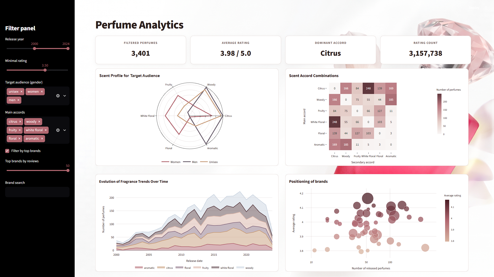

## Perfume Analysis Dashboard

An interactive data analysis and visualization web application built with Streamlit to explore perfume metadata, scent accords, and market trends.

## Key Features
- **Dynamic Filtering:** Real-time filtering by brand, release year, target audience, and scent notes.
- **Interactive Visualizations:** Distribution of main accords, popularity trends, and comparative charts powered by Plotly.
- **Optimized Performance:** Fast in-memory data handling utilizing Streamlit's `@st.cache_data`.

**Source:** [Perfume Dataset on Kaggle](https://www.kaggle.com/datasets/olgagmiufana1/fragrantica-com-fragrance-dataset)

**Live Link Demo:** [View Dashboard](https://perfume-dashboard-5xbicvxzrdkjvmgmwhcna9.streamlit.app/)

